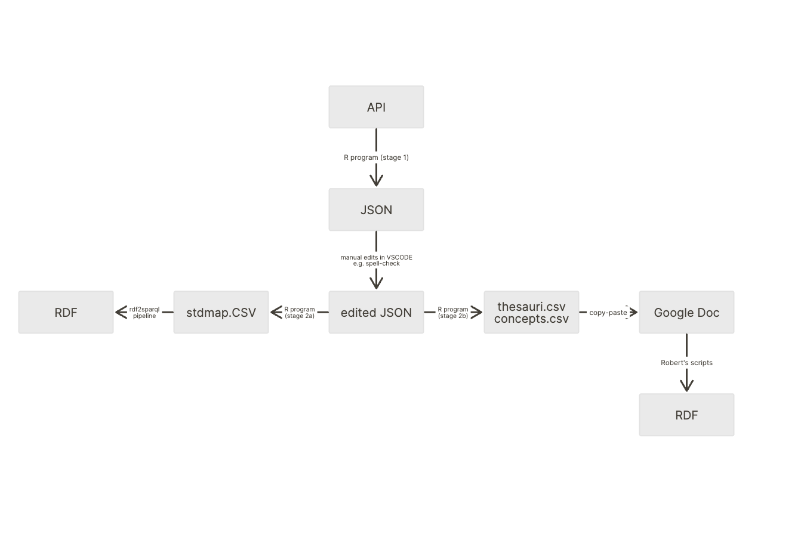

# Standards Map RDFization

Standards Map is

> The world’s largest database for sustainability standards

In this directory we have put various tools to extract them in a structured
format.

There are two undocumented public API endpoints:

  1.
  https://api.production.standardsmap.sustainable-trade.org/api/standards?client=NO%20AFFILIATION
  2.
  https://api.production.standardsmap.sustainable-trade.org/api/standards/<ID>/all?preview=false

The first one has no arguments. In the second <ID> has to be replaced with
standard ID, for example 496 or 100000. The first one returns info on all
standards, the second one returns detailed information about a particular
standard.

## Transformation pipeline

We use R code to scrape JSON as `data/stdmap-uncorrected.JSON` from the API
(stage 1).

Then we do manual edits on the JSON resulting in `data/stdmap.csv`
(spell-checking).

Then we use R code for create a `data/stdmap.csv` (stage 2a) that we then
process with the `rdf2sparql` tools into RDF. This stage contains automatic
filtering and data-cleaning.

Then we use R code to create `data/thesauri.csv` and `data/concepts.csv` (stage 2b) that go
into the Google Doc for further processing.
